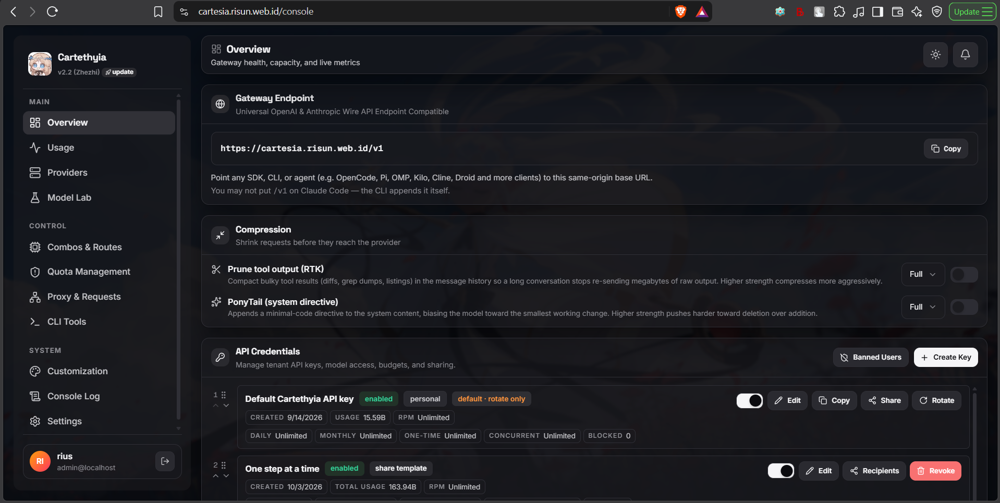
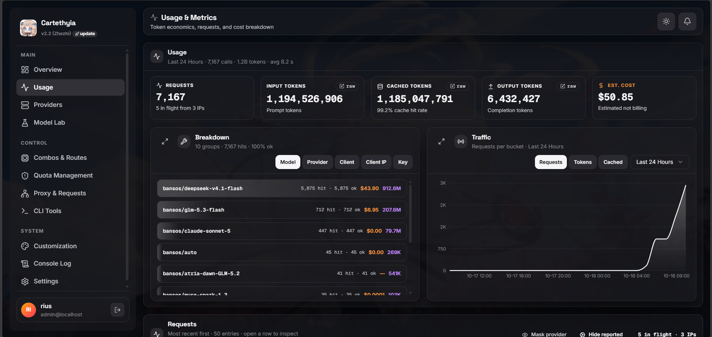
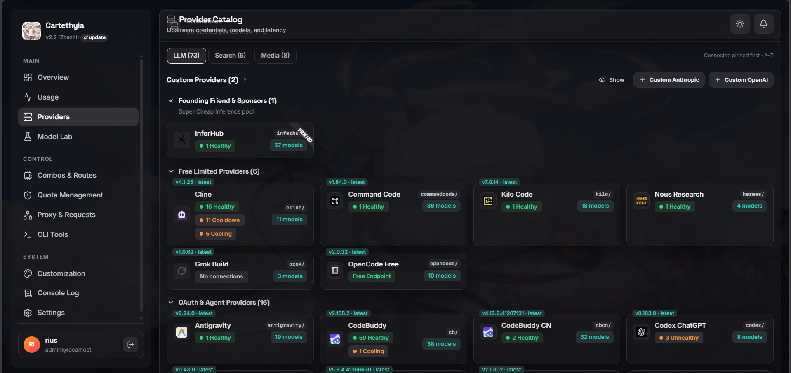
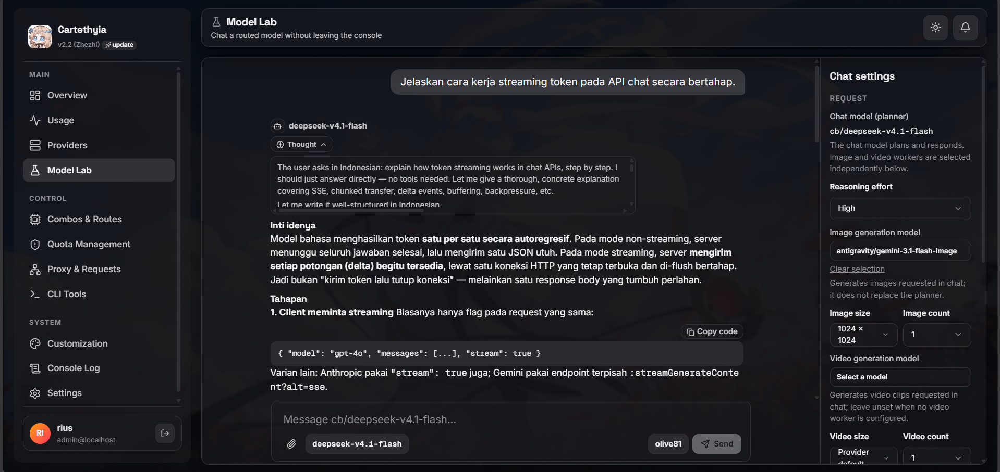
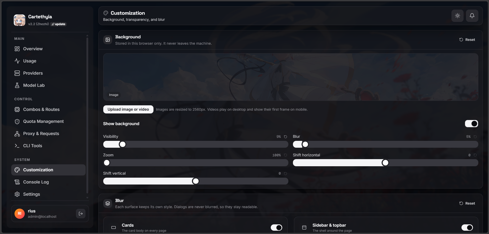
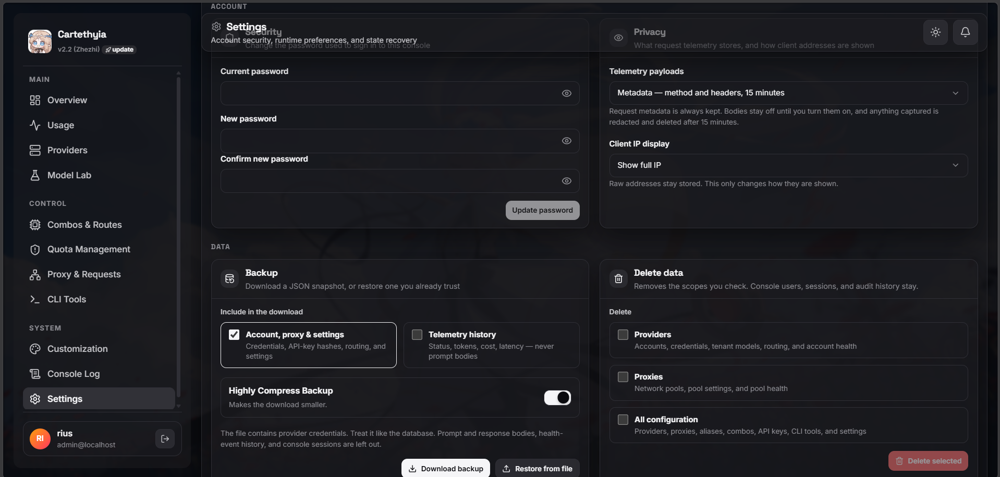

# Cartethyia


**A self-hosted multi-provider AI gateway.**

Cartethyia gives AI clients one stable, OpenAI- and Anthropic-compatible endpoint while the gateway handles the operational work behind it: provider-aware translation, account selection, health-aware failover, quota and cooldown enforcement, usage accounting, telemetry, and optional proxy pools.

Configure provider accounts once, issue an API key, and point OpenCode, Droid, Cline, Claude Code, Codex, or any compatible client at Cartethyia. The client keeps its native protocol; Cartethyia normalizes the request, selects a viable route, dispatches upstream, and returns the response in the contract the client expects.

Built with Bun, TypeScript, Elysia, embedded SQLite or external PostgreSQL, and optional Redis coordination.

##  Installation

You need Node/npm and **Bun 1.4.0 or newer**.

```bash
npm install --global cartethyia
cartethyia setup
carte
```

Full install guide, modes, Docker, VPS, systemd, and the one-shot script:
[getting started](documentation/getting-started.md). To remove it:
`npm uninstall --global cartethyia`.

##  What it actually does

- **Speaks the provider's own dialect.** Per-provider adapters reproduce the
  client identity, headers, and billing signals the provider expects.
- **Routing looks at health.** Model, alias, combo, capability, account state,
  cooldown, quota, and whether the provider is up — one decision, one plan.
- **A retry still counts.** Failover does not skip admission, usage, quota, or
  telemetry; failures stay distinct instead of collapsing to one 502.
- **You can see the whole hop.** Bounded, redacted capture of what the client
  sent, what Cartethyia translated, what the provider returned, and what the
  client got.

Full list, with the custom-built capabilities and how they differ from plain
forwarders: [Why Cartethyia](documentation/why-cartethyia.md).

##  Showcase

The console that ships with the gateway — what an operator actually looks at.

 

 

 

##  Routes


| Route                   | For                                       |
| ----------------------- | ----------------------------------------- |
| `/v1/chat/completions`  | OpenAI-style chat                         |
| `/v1/responses`         | Responses API, including Codex tools      |
| `/v1/messages`          | Anthropic Messages, including Claude Code |
| `/v1/models`            | What this key can call                    |
| `/v1/completions`       | Legacy text completions                   |
| `/v1/responses/compact` | Responses compaction                      |
| `/v1/search`            | Web search                                |
| `/v1/systemone`         | System One                                |


The route picks the wire. After that, routing, admission, retry, and accounting
are the same.

##  Lite or Full

Same app either way. Lite is not a cut-down edition.


|          | Pick it when                                                                       |
| -------- | ---------------------------------------------------------------------------------- |
| **Lite** | One person, one machine, or you just want it running                               |
| **Full** | Several people, a VPS, or the process is busy enough that SQLite is the bottleneck |


Docker Compose defaults to Full. A local `.env` defaults to Lite. When Lite
gets tight, export a JSON backup and restore it into Full. You do not rebuild
the config.

Details: [Getting started](documentation/getting-started.md#2-choose-a-database-mode).

##  License

[GNU GPL v3.0 only](LICENSE). You can use, change, and share it. If you ship a
build or a fork, ship the source with it, under the same license. No warranty.