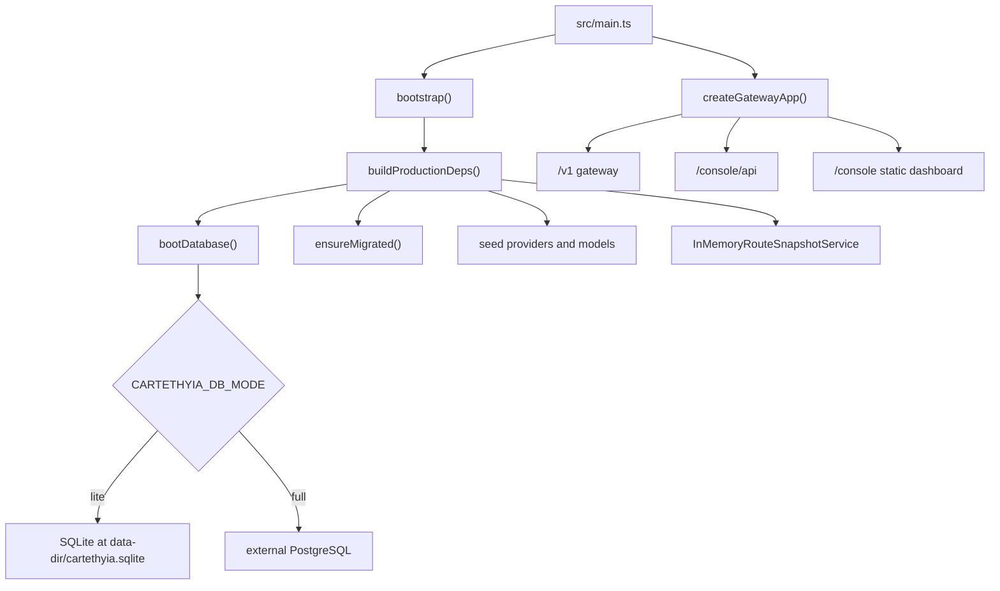
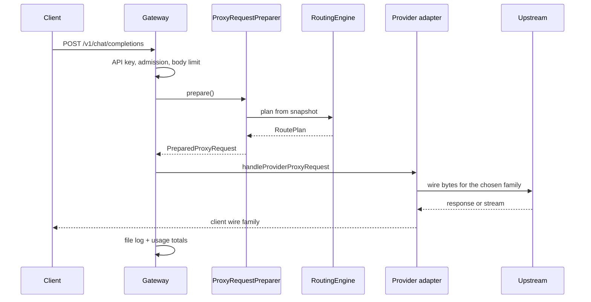
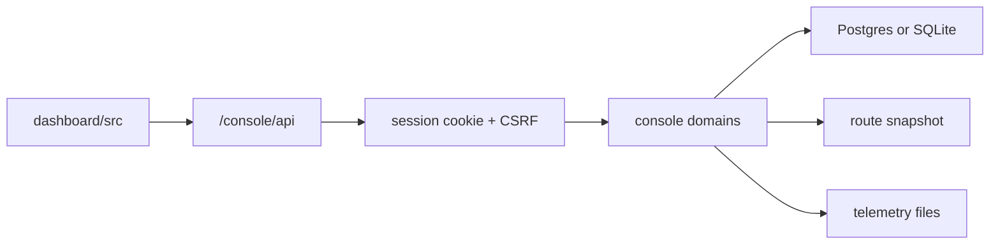

# Architecture

Cartethyia is one process that serves two surfaces. Clients send OpenAI, Anthropic,
or Responses requests to the gateway. Operators manage that gateway through the
console, which the same process serves at `/console`.

The production backend is `src/`. The browser app is `dashboard/src/`. The browser
never imports Elysia, the database, or secrets. It talks to `/console/api` and
renders what that API returns. It does re-export a handful of *pure* values from
`src/` — dimension and scope lists, the release comparator, a thinking-suffix
formatter — so an enum cannot drift between the two sides; those modules are
valueless, and nothing runtime crosses with them.

## Process



`src/main.ts` boots once, then builds the Elysia app. `Manifest.isCapturing()` skips
the boot and builds an empty shell so the route table can be captured without a
database. Shutdown drains in-flight requests through `shutdownCoordinator`, then
force-exits if the drain budget elapses.

## Request path

A client request does not hit a provider directly. It is authenticated, translated
into one canonical request, planned against a frozen route snapshot, and only then
dispatched. Failover walks the plan. It does not rebuild it.



The canonical model is the boundary between client wire and provider wire. A chat
client can be served by a Responses or Messages provider because both sides are
encoded from the same request. `src/protocol/registry.ts` is the switch, selected
by the provider's `wire_family` (`src/protocol/canonical-model.ts:15`):
`chat`, `responses`, and `messages`. `gemini` — Factory's native
`generateContent` wire — is a member of the enum but is **not** a codec: it is
dispatched by the Factory adapter's own native path, and `registry.ts` throws
on it. There is no `native` family. A provider that frames its
own wire says so on its metadata, not in the enum.

## Ownership

| Layer | Owns | Does not own |
| --- | --- | --- |
| `src/protocol` | Canonical request, codecs, `GatewayError` | Provider HTTP, routing |
| `src/transport` | Auth pipeline, planning, dispatch, streaming | Provider-specific bytes |
| `src/providers` | Adapter, auth, discovery, quota, specs | Which account is chosen |
| `src/network` | Egress pools, SSRF, retry, outbound fetch | Model selection |
| `src/security` | API keys, admission, CSRF, abuse | Console page state |
| `src/persistence` | Schema, migrations, stores, Redis | Request translation |
| `src/observability` | File event log, metrics, payload capture | Usage UI |
| `src/console` | Operator API under `/console/api` | Browser rendering |
| `dashboard/src` | Browser UI | Database, secrets, Elysia |

## Routing snapshot

`InMemoryRouteSnapshotService` builds one frozen snapshot: candidates, aliases,
combos, provider routing, and pool routing. A console mutation calls `invalidate()`,
which bumps the revision and drops the cache. The next request rebuilds. The
mutation itself does not wait for the eleven database reads a rebuild issues
(providers, models, accounts, aliases, combos, provider and pool routing
settings, disabled models, and the two CLI mapping tables).

`RoutingEngine` turns a requested model into a `RoutePlan`. A bare name matches
`model_id`. A `provider/model` name matches both. Alias and combo lookup happen
before candidate filtering; eligibility runs after it. Each of those has its own
page: [routing aliases and combos](../features/routing-aliases-combos.md) for the
name resolution itself, and [CLI model mapping](../features/cli-model-mapping.md)
for the per-key slot table that merges into the same resolver.

`EligibilityEvaluator` then drops candidates that cannot serve the request:

| Status | Eligible | Reason |
| --- | --- | --- |
| locked | no | `locked` |
| disabled | no | `disabled` |
| model cooldown | no | `model_cooldown` |
| hard cooldown | no | `cooldown_hard` |
| soft cooldown | yes | `cooldown` |
| quota exhausted | no | `quota_exhausted` |
| usage floor | no | `quota_exhausted` |
| slow lane | yes | `slow` |
| otherwise | yes | `healthy` |

Admission is separate from eligibility. Eligibility says the account may be tried.
Admission says a concurrency slot is free. Redis holds the slot when `REDIS_URL`
is set. Otherwise the slot is in-process.

Quota eligibility is also evaluated per account before dispatch. A configured
Usage floor excludes accounts whose known allowance is at or below the
threshold; a missing reading remains unknown rather than exhausted. See
[Usage floor](../features/usage-floor.md) for its accounting and cache behavior.

## Data

```mermaid
flowchart LR
  req[\"request\"] --> file[\"data/telemetry-events/<day>.events.jsonl\"]
  file --> index[\"data/telemetry-events/<day>.index.json\"]
  req --> totals[\"telemetry_usage_totals\"]
  req --> payload[\"telemetry_payloads index\"]
  payload --> frames[\"payload frame files\"]
  console[\"usage, breakdown, chart\"] --> index
  console[\"request list, detail\"] --> file
  console --> totals
```

Per-request events are appended to one file per UTC day —
`<YYYY-MM-DD>.events.jsonl` — not rows in `telemetry_events`. The day file is
append-only and is never rewritten while the day is open.

Beside it, `<YYYY-MM-DD>.index.json` carries the running totals, the per-name
breakdown sums, per-hour slots, and a byte watermark of how much of the event
file has been folded in. Usage totals, the breakdown, and the traffic chart
read **the index**; only the request list and the detail drawer read the event
file, and they read backwards from its tail in blocks. A usage query therefore
costs a few small JSON reads rather than a parse of the whole period, and its
cost does not grow with traffic.

Folding is incremental and idempotent, driven by the watermark rather than by
comparing file names. An unterminated line — one the writer may still be
appending to — is left for the next pass instead of counted.

Retention deletes whole days, the event file and its index together.

The database keeps lifetime totals and a short-lived payload index. Payload
bodies are files. The payload index stores `storage`, `file`, `offset`,
`length`, `checksum`, and `version`.

Two database modes share one schema:

| Mode | Database | Coordination |
| --- | --- | --- |
| Lite | embedded SQLite at `<data-dir>/cartethyia.sqlite` | in-process unless `REDIS_URL` is set. One process is the whole deployment, so the in-process admission counters are the shared counters; set `REDIS_URL` only to share them with a second process |
| Full | external PostgreSQL | Redis when `REDIS_URL` is set, else memory |

The PostgreSQL baseline defines the foundational schema for a new database;
both backends to the current schema. **In-place upgrades are not supported.**
An existing database with retired migration history, or
tables without the current baseline ledger entry, is rejected at startup.
Create a fresh database and restore a backup. Restore maps the retired
`bypass_proxy` name, `bridge` pool kind, old provider User-Agent default, and
legacy Cline/fusion values to the current schema.

## Console and dashboard

The dashboard is a Vite React app. The backend serves the built files and injects
route-specific social tags in `src/console/dashboard-assets.ts`, because crawlers
do not run the bundle. There is one `dashboard/index.html`.



A console mutation that changes routing, keys, pools, or CLI mappings invalidates
the route snapshot. The next gateway request sees the new revision. The page does
not push state into the gateway by any other path.

## What is intentionally absent

- Fusion combos. Existing rows become `fallback` on restore (`src/console/backup/validate.ts:120-121`).
- A `native` wire family and a `degraded` health status.
- Per-request rows in Postgres. The file log is the source for those reads.
